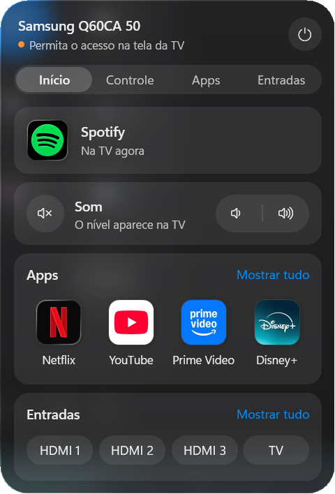
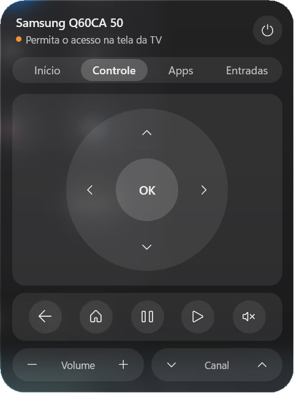
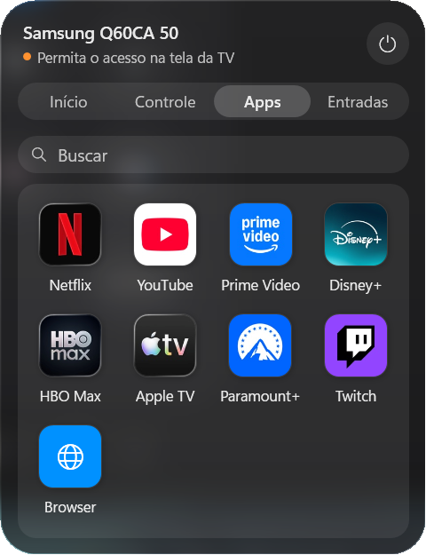
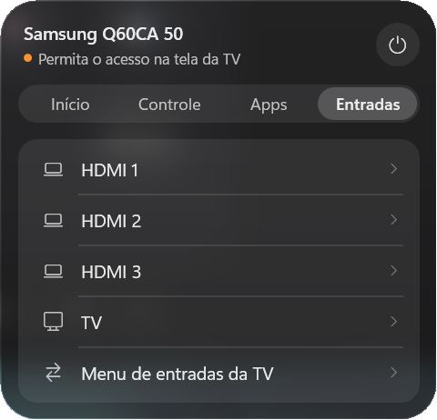

# TV Remote para Windows

Controle remoto para TVs Samsung (Tizen) que mora na bandeja do Windows, ao lado do relógio. Um clique no ícone abre um painel no estilo da Central de Controle do macOS Tahoe.

| Início | Controle | Apps | Entradas |
| :---: | :---: | :---: | :---: |
|  |  |  |  |

## O que faz

- Acha a TV sozinho na rede.
- **Controle:** direcional, OK, voltar, início, play/pausa, volume, mudo e canal. Também funciona pelo teclado.
- **Modo teclado:** o botão redondo com o teclado, no canto do direcional, faz as setas e o Enter controlarem a TV de qualquer janela, mesmo com o painel fechado. O ícone da bandeja fica azul enquanto isso. Esc desliga.
- **Apps:** mostra os apps instalados com os ícones oficiais, diz qual está aberto na TV e abre o app com um clique.
- **Entradas:** troca para HDMI 1, 2, 3 ou TV aberta.
- **Ligar:** com a TV desligada, o botão de ligar manda um sinal pela rede (Wake-on-LAN).

Testado em uma Samsung Q60C (2023, Tizen 7). Deve funcionar nas Samsung de 2016 em diante, mas não foi testado nelas.

## Compilar e abrir

Só precisa do Windows 10 ou 11: o projeto usa o .NET Framework que já vem no sistema.

```bat
build.cmd
TVRemote.exe
```

O ícone de TV aparece na bandeja. Clique esquerdo abre o painel; clique direito tem **Procurar a TV de novo** e **Sair**.

## Na TV, uma vez

1. Deixe o PC e a TV na mesma rede.
2. Em **Configurações → Conexão → Rede → Configurações avançadas**, ligue **Controle remoto IP**. Ligue também **Ligar com celular** para o botão de ligar funcionar com a TV desligada.
3. Quando o app conectar, a TV pergunta se permite o acesso de **Controle do PC**. Escolha **Permitir**.
4. Para ela não perguntar toda vez: **Conexão → Gerenciador de dispositivos externos → Gerenciador de conexão de dispositivo → Notificação de acesso → Somente na primeira vez**.

## Atalhos do teclado

| Tecla | Ação |
| --- | --- |
| Setas, Enter | Navegar e OK |
| Backspace | Voltar |
| H | Início |
| M | Mudo |
| + / − | Volume |
| Esc | Fechar o painel (no modo teclado: desligar o modo) |

Esses atalhos valem com o painel aberto. No modo teclado, as setas, o Enter e o Esc funcionam em qualquer janela.

## Como funciona

- **Teclas:** WebSocket da própria TV (`wss://TV:8002`, canal `samsung.remote.control`), com o token que a TV dá na primeira permissão.
- **Apps:** a TV não lista os apps instalados nos modelos novos, mas responde por ID (`http://TV:8001/api/v2/applications/<id>`). O app pergunta por uma lista fixa e abre o app pelo mesmo endereço. Para incluir um app, acrescente o ID dele em `Catalog`, em `TVRemote.cs`.
- **Ícones:** vêm da busca pública da App Store (`itunes.apple.com/lookup`), na loja do país da TV, e ficam guardados no PC. Nenhum ícone vai no repositório.
- **Visual:** medidas do Human Interface Guidelines da Apple: texto 13/11 pt, cores de sistema do modo escuro, cantos concêntricos (26 no painel, 14 nos módulos) e controles em cápsula. O fundo de vidro é a tela atrás do painel, desfocada no momento em que ele abre.

O IP, o endereço MAC e o token da TV ficam em `%APPDATA%\TVRemote`, no seu PC.

## Arquivos

| Arquivo | O que é |
| --- | --- |
| `TVRemote.cs` | A conexão com a TV e o painel |
| `TVRemote.xaml` | O visual do painel |
| `build.cmd` | Compila o `TVRemote.exe` |

Projeto independente, sem ligação com a Samsung ou a Apple. Nomes e ícones de apps pertencem aos donos.
